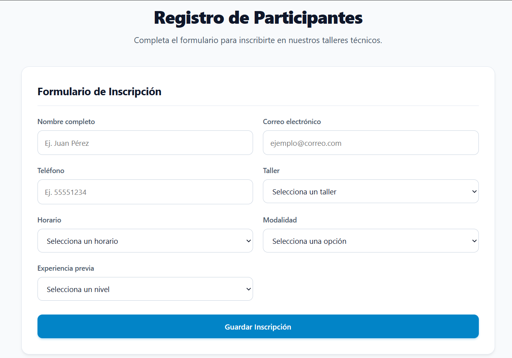
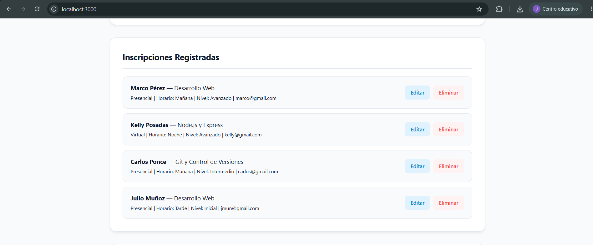
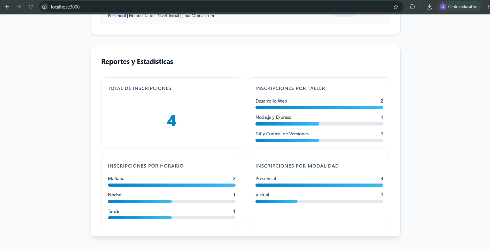

# Sistema de Registro de Participantes para Taller

Aplicación web integral para la gestión, registro, persistencia y análisis visual de participantes en talleres técnicos. Proyecto desarrollado con arquitectura cliente-servidor utilizando Node.js, Express, SQLite y JavaScript Vanilla.

---

## Características Principales

- **Gestión Completa (CRUD):** Creación, consulta, edición y eliminación de inscripciones en tiempo real mediante API REST.
- **Persistencia Relacional:** Almacenamiento seguro en base de datos SQLite integrada (`node:sqlite`) con esquema estructurado.
- **Doble Capa de Validación:**
  - *Frontend:* Atributos HTML5 (`required`, `type="email"`) y control de eventos para experiencia de usuario fluida.
  - *Backend:* Saneamiento y validación estricta de cadenas y formato regex en el servidor Express.
- **Reportes Visuales Dinámicos:** Métrica global y barras de distribución calculadas directamente mediante consultas agregadas SQL (`COUNT`, `GROUP BY`).
- **Diseño Responsivo:** Maquetación con CSS Grid y Flexbox adaptable a computadoras de escritorio y dispositivos móviles (`@media max-width: 600px`).

---

## Estructura del Proyecto

```text
├── database.js          # Configuración y conexión de SQLite (node:sqlite)
├── server.js            # Servidor Express y endpoints de la API REST
├── package.json         # Dependencias y scripts del proyecto
├── .gitignore           # Exclusión de node_modules y base de datos local
├── README.md            # Documentación general y guía de ejecución
├── bitacora.md          # Registro teórico, quizzes y defensa oral
└── public/              # Archivos estáticos del frontend
    ├── index.html       # Estructura semántica del formulario y reportes
    ├── styles.css       # Estilos visuales y diseño adaptable
    └── app.js           # Lógica asíncrona (fetch) y manipulación del DOM
```

---

## Endpoints de la API REST

| Método | Ruta | Descripción |
| :--- | :--- | :--- |
| `GET` | `/api/inscripciones` | Obtiene la lista completa de registros ordenados de forma descendente. |
| `POST` | `/api/inscripciones` | Valida y guarda una nueva inscripción en la base de datos (HTTP 201). |
| `PUT` | `/api/inscripciones/:id` | Modifica los datos de una inscripción existente según su ID. |
| `DELETE`| `/api/inscripciones/:id` | Remueve una inscripción del registro según su ID. |
| `GET` | `/api/reportes/resumen` | Consulta conteos agrupados por taller, horario y modalidad para los reportes. |

---

## Requisitos Previos

- **Node.js:** Versión 22.13 o superior (cuenta con el módulo nativo `node:sqlite`).
- **Navegador web moderno:** Chrome, Firefox, Edge o Safari.

---

## Instrucciones de Instalación y Ejecución

1. **Clonar o descargar el repositorio:**
   ```bash
   git clone https://github.com/JulioPonce77/registro-taller-estudiante.git
   cd registro-taller-estudiante
   ```

2. **Instalar dependencias:**
   ```bash
   npm install
   ```

3. **Iniciar el servidor local:**
   ```bash
   npm start
   ```

4. **Abrir en el navegador:**
   Acceder a `http://localhost:3000`.

---

## Evidencias de Funcionamiento

### Formulario de Registro


### Lista con Acciones (Editar / Eliminar)


### Reportes Visuales Calculados desde la Base de Datos
